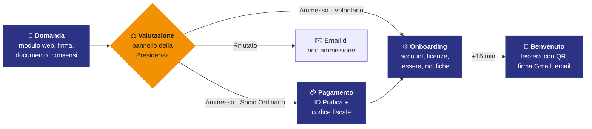

<div align="center">

<a href="https://newpercussion.it/workflow/">
  
</a>

# Nonprofit Membership Workflow

### Dalla domanda di ammissione alla tessera, senza passaggi manuali.

Il gestionale soci open-source per gli enti del Terzo Settore, costruito interamente su **Google Apps Script**.<br>
Ammissioni, account, quote, libri sociali e comunicazioni: un solo sistema, gratuito per APS, ODV ed ETS.

<sub><i>Open-source membership management for Italian non-profits — from application to member card, fully automated.</i></sub>

<br>

[](https://newpercussion.it/workflow/)
[](https://developers.google.com/apps-script)
[](LICENSE)
[](https://newpercussion.it/workflow/conformita/)

**[📖 Documentazione](https://newpercussion.it/workflow/)** &nbsp;·&nbsp;
**[🛠️ Installazione](https://newpercussion.it/workflow/installazione/)** &nbsp;·&nbsp;
**[⚙️ Configuratore](https://newpercussion.it/workflow/configura/)** &nbsp;·&nbsp;
**[🏗️ Architettura](https://newpercussion.it/workflow/architettura/)** &nbsp;·&nbsp;
**[🆘 Assistenza](https://newpercussion.it/workflow/assistenza/)**

</div>

---

## ✨ Perché esiste

La maggior parte delle associazioni gestisce le iscrizioni con moduli sparsi, fogli di calcolo copiati a mano ed email scritte una per una. Questo progetto nasce dentro un'orchestra giovanile per togliere tutto quel lavoro ai volontari, **senza togliere a nessuno il potere di decidere**.

> **Una persona, una decisione.** Su cinque momenti del percorso, solo uno richiede un essere umano: la delibera della Presidenza. Tutto il resto — email, account, tessera, ricevuta, libri sociali — accade da solo.

## 🔀 Domanda e pagamento, separati

È la scelta che spiega tutto il resto: **nessuno compra l'adesione a un'associazione**. Prima la Presidenza valuta, poi — solo chi è stato ammesso — riceve l'invito a versare la quota.



|  | **Fase 1 · Domanda** | **Fase 2 · Pagamento** |
|---|---|---|
| **Chi** | chiunque | solo un Socio Ordinario già ammesso |
| **Cosa** | anagrafica, documento, consensi, firma | quota associativa annuale |
| **Identificazione** | nessuna | ID Pratica + codice fiscale |
| **Esito** | riga a registro, email di conferma, notifica allo staff | incasso, ricevuta PDF, avvio automatico dell'onboarding |

> 👨‍👧 **E i volontari minorenni?** Indicano il genitore che è già Socio Ordinario. La pratica resta in attesa finché quel genitore non è ammesso e in regola — e **si sblocca da sola** nel momento in cui accade.

## 🧩 Dodici attività, gestite da sole

<table>
<tr>
<td width="33%" valign="top">

**📝 Modulo di iscrizione proprio**<br>
Web app multilingua, firma sul touch, allegati compressi nel browser. Nessun servizio di moduli esterno.

</td>
<td width="33%" valign="top">

**👨‍👧 Volontari e genitori**<br>
Il sistema verifica il legame genitore–figlio e attende, sbloccandosi da solo quando il genitore è in regola.

</td>
<td width="33%" valign="top">

**🏛️ Pannello Presidenza**<br>
Ammissione, rifiuto, cessazione ed espulsione da un'interfaccia riservata, senza toccare il foglio.

</td>
</tr>
<tr>
<td valign="top">

**🔁 Quote e rinnovi**<br>
Pagamento, rinnovo annuale automatico, morosità, annullamenti e rimborsi via Stripe.

</td>
<td valign="top">

**🧾 Ricevuta e contabilità**<br>
Ogni quota genera una ricevuta PDF e una riga nel registro dei movimenti.

</td>
<td valign="top">

**👤 Account automatici**<br>
Utenze Google Workspace e Microsoft 365, gruppi di dominio, sospensione alla cessazione.

</td>
</tr>
<tr>
<td valign="top">

**🪪 Tessera associativa**<br>
PDF con QR code generato da un template Google Slides.

</td>
<td valign="top">

**✉️ Email transazionali**<br>
Una venticinquina di messaggi HTML con la veste grafica dell'ente.

</td>
<td valign="top">

**📚 Libri sociali**<br>
Libro degli associati e registro dei volontari, con numerazione stabile e conservazione dei cessati.

</td>
</tr>
<tr>
<td valign="top">

**📸 Liberatorie immagini**<br>
Consenso canale per canale, doppia firma dei genitori, revocabile in ogni momento.

</td>
<td valign="top">

**🔗 Registro degli eventi**<br>
Storia dei calendari in sola aggiunta, con catena di impronte SHA-256 verificabile.

</td>
<td valign="top">

**🔔 Notifiche allo staff**<br>
Ogni domanda ed esito su Google Chat, con coda notturna e link diretto alla pratica.

</td>
</tr>
</table>

## 🏛️ Chi decide resta chi decide

Il pannello **esegue** ciò che gli organi dell'ente deliberano: non prende il posto di nessuno. È una scelta di progetto, non un limite tecnico.

- ✅ L'ammissione decisa dal componente delegato viene annotata con autore, data e **termine entro cui l'organo deve ratificarla**.
- ⚖️ L'espulsione è **in due tempi**: prima la proposta, con l'invito all'interessato a esporre le proprie ragioni; poi la delibera dell'Assemblea con gli estremi del verbale.
- ⏸️ Finché la proposta è aperta **non cambia nulla**: accessi, quota e posizione restano quelli di prima.
- 📅 La cessazione distingue le sue cause — decadenza, recesso, perdita della capacità di agire, decesso — ognuna con la propria data di efficacia.
- 🕓 Ogni passaggio finisce nella cronologia della pratica, con chi l'ha fatto e quando.

## 🪶 Funziona anche se non hai…

La maggior parte delle APS non ha Google Workspace, Microsoft 365 né un conto per i pagamenti online. Il sistema **spegne i pezzi che mancano** invece di rifiutarsi di partire.

| Se l'ente non ha… | Si spengono | Che cosa succede |
|---|---|---|
| Google Workspace | account istituzionali, firma Gmail | Il socio resta socio: il benvenuto arriva al suo indirizzo personale. |
| Microsoft 365 | utenze Office | Non bloccante: l'errore è annotato sulla pratica e l'onboarding prosegue. |
| Un servizio di pagamento | quota online, ricevuta, modulo di pagamento | La quota si incassa fuori e la Presidenza la segna come regolare dal pannello. |
| Tessere associative | generazione del PDF | L'email di benvenuto parte senza allegato. |
| Google Chat | notifiche allo staff | Il pannello resta la fonte di verità. |
| Un'app mobile | API JSON e sincronizzazione | Nessun effetto: la sincronizzazione si salta da sé. |

**🎯 Nucleo minimo:** con i moduli `0` `1` `2` `6` `7` `12` `15` `17` `20` più le pagine di iscrizione e del pannello hai già un sistema completo — domanda online, delibera, libro degli associati ed email. Nove moduli, zero servizi a pagamento.

## 🌐 Un URL, sei pagine

Tutte le interfacce vivono sullo stesso deployment e si distinguono per parametro:

| Indirizzo | Pagina |
|---|---|
| `/exec` | Modulo di iscrizione — **il link da pubblicare sul sito** |
| `/exec?pagina=paga` | Modulo di pagamento della quota |
| `/exec?pagina=presidenza` | Pannello della Presidenza (protetto dal gruppo, non dall'indirizzo) |
| `/exec?pagina=presidenza&formato=json` | Le stesse azioni in JSON, per l'app mobile |
| `/exec?pagina=liberatoria` | Liberatoria immagini, con token personale |
| `POST /exec` | Eventi di pagamento, in arrivo dal [Worker Stripe](stripe-webhook-proxy/) |

## 🚀 Avvio rapido

```text
1. ⚙️  Genera il pacchetto con il Configuratore  →  newpercussion.it/workflow/configura
       (tutto nel browser, nessun dato inviato)  — oppure sostituisci a mano i {{TOKEN}} in src/
2. 📄  Dal foglio dati: Estensioni › Apps Script — crea i moduli 0–8 e 10–22 e le 4 pagine HTML
3. 🧾  Sostituisci il manifest con src/appsscript.json · fuso orario Europe/Rome
4. 🌍  Deploy › New deployment › Web app  (Esegui come: me · Accesso: chiunque)
5. ▶️  Esegui una volta inizializzaColonneAggiuntive() e installaTriggers()
6. 💳  Usi Stripe? Pubblica il Worker in stripe-webhook-proxy/ (Apps Script risponde 302, Stripe no)
```

La procedura completa — dieci fasi dalla A alla J, con libri sociali e collaudo end-to-end — è nella **[guida all'installazione](https://newpercussion.it/workflow/installazione/)**.

> [!WARNING]
> **Le tue chiavi non vanno mai qui.** I sorgenti di questo repository contengono solo segnaposto. Dopo la configurazione il tuo `0_Secrets.gs` conterrà chiavi reali: non caricarlo su repository pubblici, non inviarlo per email e, se esposto, ruota subito le chiavi. Meglio ancora: spostale nelle *Script Properties*.

> [!TIP]
> **«Ho corretto il codice ma non cambia niente».** Salvare nell'editor non aggiorna l'URL `/exec`: serve una nuova versione del deployment (*Deploy › Manage deployments › Edit › New version*).

## 📁 Struttura del repository

```text
.
├── src/                         sorgenti pubblici con segnaposto {{TOKEN}}
│   ├── 0_Secrets.gs             valori sensibili (qui solo segnaposto)
│   ├── 1_CONFIG_V8.gs           configurazione globale dell'ente
│   ├── 2_ … 22_*.gs             moduli Apps Script
│   ├── 12_footer                footer di attribuzione delle email
│   ├── *HTML.html               le quattro pagine delle web app
│   ├── appsscript.json          manifest (Admin SDK, People, Calendar)
│   └── Template_Tessera.pptx    template della tessera, pronto da personalizzare
├── stripe-webhook-proxy/        Cloudflare Worker tra Stripe e Apps Script
└── LICENSE                      licenza duale
```

<details>
<summary><b>🔍 Tutti i 23 moduli, uno per uno</b></summary>

<br>

| Modulo | Ruolo | |
|---|---|---|
| `0_Secrets.gs` | Contenitore unico dei valori sensibili | 🟠 Core |
| `1_CONFIG_V8.gs` | Identità dell'ente, mappa colonne, design email, cessazioni, trigger | 🟠 Core |
| `2_TriggerAmmissione.gs` | Il cuore: ammissione, rifiuto, lavori differiti, onboarding, recupero | 🟠 Core |
| `3_StripeAdmin.gs` | Abbonamenti, rinnovi, morosità, annullamenti, rimborsi | ⚪ Opzionale |
| `4_WorkspaceAdmin.gs` | Account Google Workspace e Microsoft 365, gruppi di dominio | ⚪ Opzionale |
| `5_TesseraGenerator.gs` | Tessera PDF da template Slides, con QR | ⚪ Opzionale |
| `6_Mail.gs` | Circa venticinque email transazionali HTML | 🟠 Core |
| `7_RouterModuli.gs` | Nuove domande, doppi invii, legame volontario–genitore | 🟠 Core |
| `8_NotificheChat.gs` | Notifiche Google Chat con coda notturna | ⚪ Opzionale |
| `9_MembroPortal.gs` | Portale membri (progetto Apps Script separato) | ⚪ Opzionale |
| `10_GmailFirma.gs` | Firma Gmail istituzionale via delega di dominio | ⚪ Opzionale |
| `11_Tracer.gs` | Diario di bordo con mascheramento dei segreti | ⚪ Opzionale |
| `12_footer` | Footer di attribuzione nelle email esterne | 🟠 Core |
| `13_TestFeedback.gs` | Prova grafica dell'email di benvenuto con dati fittizi | ⚪ Opzionale |
| `14_IntegrazioneFinanza.gs` | Ricevuta PDF e registro movimenti contabili | ⚪ Opzionale |
| `15_ModuloIscrizioneWebApp.gs` | Router unico delle web app e Fase 1 | 🟠 Core |
| `16_ModuloPagamentoWebApp.gs` | Fase 2: pagamento della quota | ⚪ Opzionale |
| `17_PresidenzaAdmin.gs` | Pannello della Presidenza | 🟠 Core |
| `18_PresidenzaAdminAPI.gs` | Azioni del pannello in JSON per l'app mobile | ⚪ Opzionale |
| `19_SupabaseSync.gs` | Sincronizzazione con l'app mobile, mai bloccante | ⚪ Opzionale |
| `20_LibriSociali.gs` | Libro degli associati e registro dei volontari | 🟠 Core |
| `21_RegistroEventi.gs` | Registro eventi in sola aggiunta, catena SHA-256 | ⚪ Opzionale |
| `22_LiberatoriaWebApp.gs` | Liberatoria immagini firmata e revocabile | ⚪ Opzionale |

</details>

## 💛 Licenza: accessibile, sostenibile, riconoscente

Il software è di proprietà dell'**Orchestra Giovanile Percussioni APS ETS** ed è sviluppato da **Alessio Ciocca**.

<table>
<tr>
<td width="50%" valign="top">

### 🟢 Uso non-profit · **Gratuito**

Per enti senza scopo di lucro formalmente costituiti — APS, ODV, ETS ai sensi del D.Lgs. 117/2017, o equivalenti esteri.

- Utilizzo libero per le attività istituzionali
- Footer di attribuzione mantenuto nelle email esterne
- Nessun costo, nessuna registrazione: scarica e configura

</td>
<td width="50%" valign="top">

### 🔵 Uso commerciale · **Su licenza**

Per aziende, liberi professionisti e soggetti for-profit.

- Licenza da richiedere prima dell'utilizzo
- Ogni provento è reinvestito nelle attività dell'associazione
- 📧 **direzione@newpercussion.it** — risposta entro 5 giorni lavorativi

</td>
</tr>
</table>

**Nessun controllo, nessuna attivazione.** Il software non chiama casa, non verifica chiavi e non si disattiva: la distinzione fra uso non-profit e commerciale si regge sulla correttezza di chi lo adotta. Testo completo in [`LICENSE`](LICENSE).

---

<div align="center">

Fatto con 🥁 dall'**[Orchestra Giovanile Percussioni APS ETS](https://newpercussion.it)**

<sub>Hai adottato il workflow nella tua associazione? Faccelo sapere: è il modo più bello per dirci grazie.</sub>

</div>
